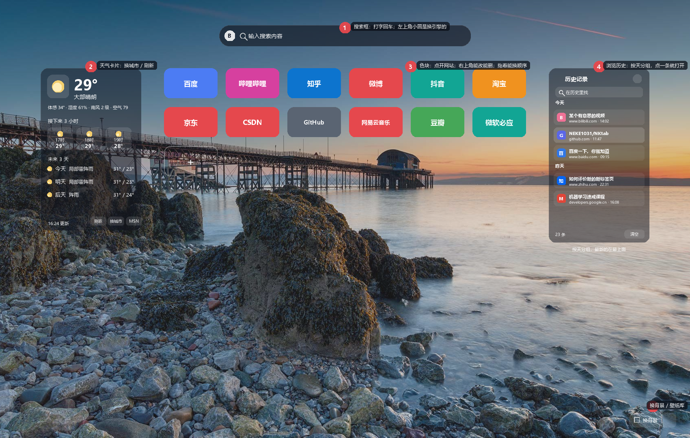
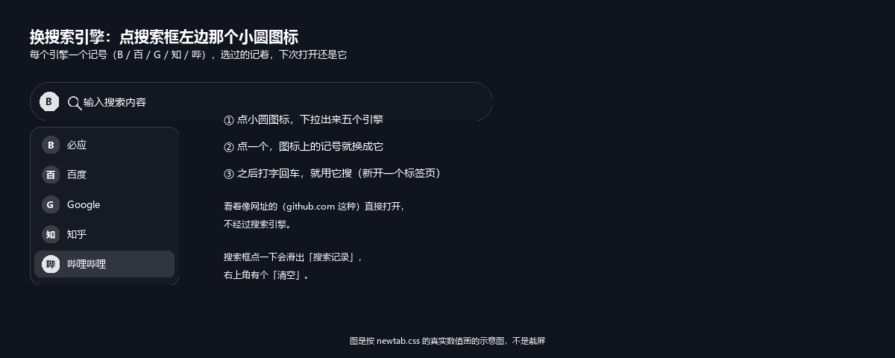
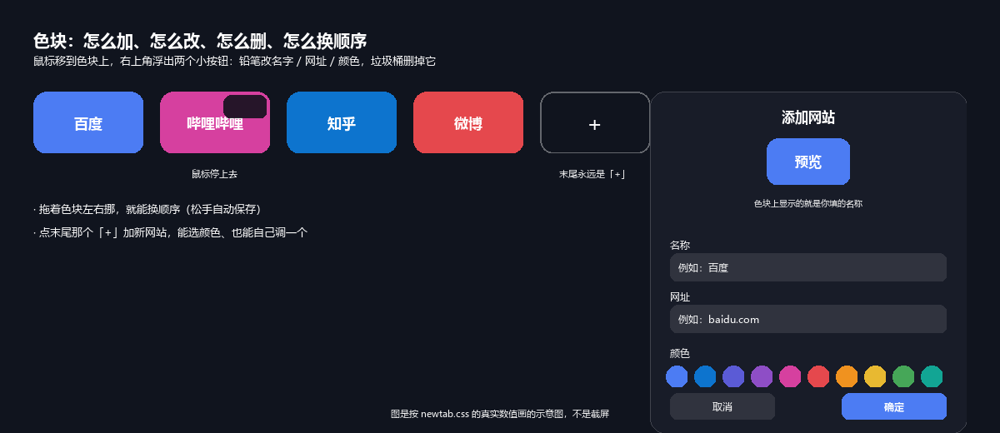
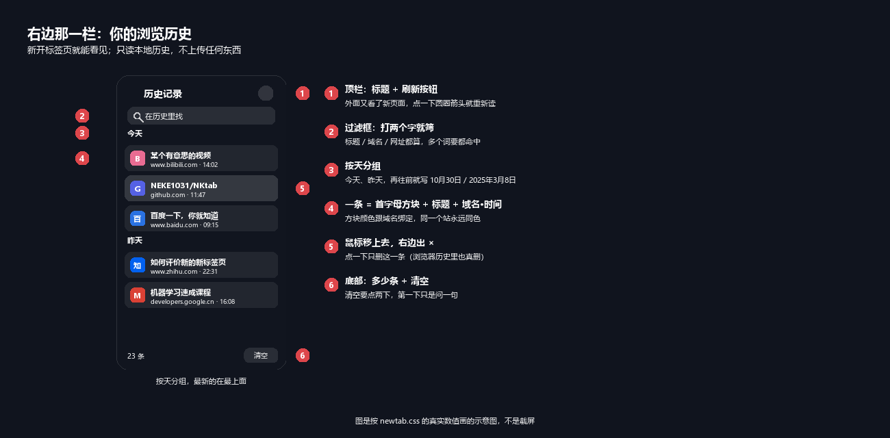
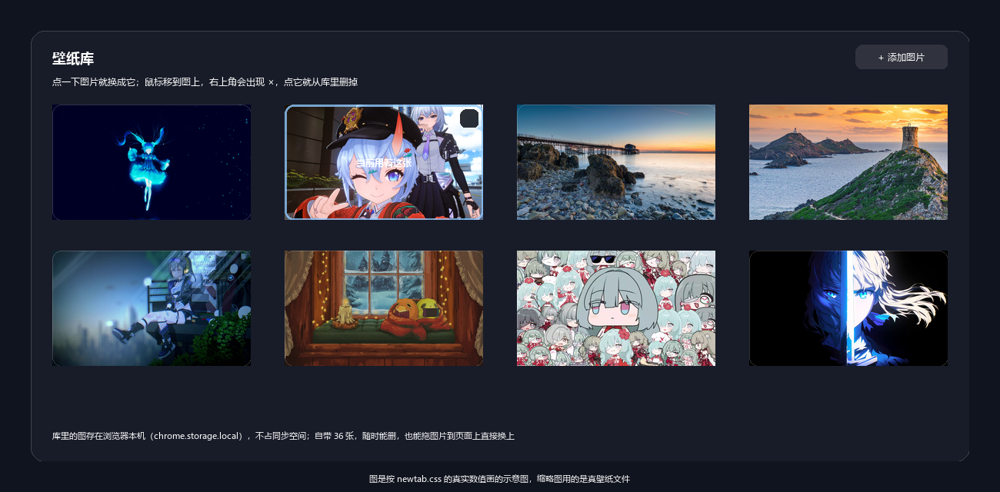

# NKtab

**作者：NEKE**（GitHub [@NEKE1031](https://github.com/NEKE1031)）——这个新标签页是我自己写着用的，顺手开源出来。

一个**不用登录、不联网也能用、不要钱**的新标签页（Edge / Chromium，Manifest V3）。
没有 AI、没有账号、没有云端壁纸——你的网站色块、壁纸、浏览历史，全都留在这台电脑和你的浏览器账号里。



---

# 一、怎么装

## 方式一：下载发布包（普通用户走这条）

1. 到 [Releases](https://github.com/NEKE1031/NKtab/releases) 下载最新的 `NKtab-v*.zip`
2. 解压得到一个 `NKtab` 文件夹，**放在一个以后不会挪走的地方**（比如 `D:\NKtab`）
   —— 扩展认的就是这个路径，文件夹挪走或者删掉，扩展就失效了
3. 打开 Edge，地址栏输入 `edge://extensions/`
4. 打开左下角的**开发人员模式**
5. 点**加载解压缩的扩展**，选中刚才那个 `NKtab` 文件夹
6. 按 `Ctrl+T` 打开新标签页

**以后升级**：下载新 zip，解压后**覆盖掉原来那个 `NKtab` 文件夹**（路径别变），
回 `edge://extensions/` 点一下刷新（↻）就行，不用重新添加。

> 发布包里**不带任何壁纸** —— `wallpapers/` 里那些是作者自己收的图，不跟着仓库和发布包走。
> 第一次打开是干净的渐变底，壁纸库是空的，点「＋ 添加图片」加自己喜欢的就行（见下面「换背景 / 壁纸库」）。

## 方式二：直接加载仓库（自己改代码走这条）

1. 把仓库 clone 下来：`git clone https://github.com/NEKE1031/NKtab.git`
2. 打开 Edge，地址栏输入 `edge://extensions/`
3. 打开左下角的**开发人员模式**
4. 点**加载解压缩的扩展**，选中 clone 下来的 `NKtab` 文件夹
5. 按 `Ctrl+T` 打开新标签页

> 装好以后新标签页就换成它了。想换回来：`edge://extensions/` 里把它停用或移除即可。

### 更新过代码之后看不到变化？

代码改完不用打包，但浏览器得知道：

1. `edge://extensions/` 里点扩展卡片上的**刷新**（↻）
2. **把已经开着的新标签页关掉**，再 `Ctrl+T` 开一个

已经开着的那一页不会自己变——它加载的是打开那一刻的旧代码。

---

# 二、怎么用

## 搜索框

|想干什么|怎么做|
|-|-|
|搜东西|在框里打字，按回车（在新标签页里打开结果）|
|直接开网址|输入 `github.com` 这种看着像网址的，回车直接打开，不经过搜索引擎|
|换搜索引擎|点框**左边那个小圆图标**，下拉里选（必应 / 百度 / Google / 知乎 / 哔哩哔哩）|
|用搜索记录|点一下搜索框，下面滑出以前搜过的；右上角有「清空」|



小圆图标里只写一个记号（`B` / `百` / `G` / `知` / `哔`），鼠标放上去能看到全名。
选过的引擎会记住，下次打开还是它。

## 网站色块

预置了一批常用站点，每个格子一个颜色，点一下就用**新标签页**打开。

|想干什么|怎么做|
|-|-|
|加一个|点末尾那个 `+`，填名字和网址（颜色能选，也能自己调一个）|
|改一个|鼠标移到色块上，右上角浮出小按钮 → 铅笔（改名字 / 网址 / 颜色）|
|删一个|同上，点垃圾桶|
|换顺序|按住色块左右拖，松手自动保存|



## 右边那一栏：浏览历史

打开新标签页，右边那一栏直接就是你最近的浏览记录 —— 不用再开 `edge://history` 翻。



|能干什么|怎么做|
|-|-|
|打开一条|点它，在新标签页里开（跟双击书签一个意思）|
|找东西|顶上那个框里打两个字，标题 / 域名 / 网址都算；多个词要**都**命中才留|
|删一条|鼠标移到那条上，右边出 `×`，点一下只删这一条|
|删全部|右下角「清空」，**点两下**才真删，第一下只是问一句，四秒不点就自己放下|
|刷新|外面又逛了新页面，点标题右边那个圆圈箭头重新读|
|看日期|按天分组：`今天`、`昨天`，再往前写 `10月30日`，跨年了写 `2025年3月8日`|

一屏只摆**最近 6 条**（`history.js` 里的 `RECENT_SHOWN`），按最近访问排，同一个网址只占一行。
左边那个小方块是域名首字母，颜色跟域名绑定 —— 同一个网站永远同一个颜色，扫一眼就认出来。

摆得少不代表找不到旧的：后面还读着 200 条（`MAX_ITEMS`），在过滤框里打两个字，**第 7 条以后的也照样能翻出来**；
命中比 6 条多的时候，底下会写成「6 / 12 条」告诉你有几条没摆出来。

> **它只读本机的历史，不上传任何东西。** 这是除了天气之外唯一碰浏览器数据的地方，
> 而且只读不写；除非你自己点了 `×` 或「清空」，否则一条都不会动。

**没给权限会怎样**：这一栏会显示「读不到浏览记录」，而不是白着。
检查 `edge://extensions/` 里这个扩展的详情，把「浏览历史」那项打开。

## 左边：天气

- 只连 MSN 天气，**这是整个扩展唯一会联网的地方**
- 换城市：天气卡底部那排小字里的「换城市」
- 刷新：同一排里的「刷新」；平时数据是缓存着的，隔一段时间才自动重新拉
- 一次显示：当前温度 / 体感 / 湿度 / 风 / 空气，接下来 3 小时，未来 3 天

## 换背景 / 壁纸库

右下角那个「换背景」按钮，或者往页面上**直接拖一张图片**，都能换。



- 自己加图：库里点「＋ 添加图片」，选本机的图；点一下就换成它
- 鼠标移到某张图上，右上角出现叉，点它就从库里删掉
- 你加的图存在浏览器本机（`chrome.storage.local`），不会同步到别的设备，也**不占**扩展目录
- 也能直接把本机的图**拖到页面上**，当场换上

> **仓库和发布包里不带壁纸。** `wallpapers/` 里那些图是作者自己收的，带个人口味，所以不跟着代码发布。
> 下载回来第一次打开，背景是一条干净的蓝色渐变，壁纸库是空的。

### 想加回「自带壁纸」（自己用的话）

代码是支持「内置壁纸」的，只是没往里放图片：

1. 在项目根目录建一个 `wallpapers/` 文件夹，把图片丢进去
2. 打开 `storage.js`，在 `BUILTIN_WALLPAPERS` 那张表里照格式登记一条：
   `{ id: "builtin:xxx", name: "显示的名字", path: "wallpapers/你的文件名.jpg" }`

图片在，壁纸库里就会把它们摆在最前面；图片不在（比如别人下载的发布包），
那一整排会被**跳过**、背景退回渐变，不会摆出一片裂图。
这段逻辑在 `newtab.js` 的 `builtinFileExists()`，`node tools\测试壁纸降级.mjs` 盯着它。

---

# 三、它把数据存在哪

|东西|存哪|会不会跟着账号同步|
|-|-|-|
|网站色块、搜索引擎、搜索记录|`chrome.storage.sync`|会（都是纯文本，很小）|
|壁纸（你加的）|`chrome.storage.local`|不会|
|壁纸（自带的，如果 `wallpapers/` 里有图）|直接读扩展目录，不占存储|不会|
|天气数据|`chrome.storage.local`|不会|
|浏览历史|**不存**，每次打开现读浏览器自己的历史|—|

扩展只要了三个权限：`storage`（存上面那些）、`unlimitedStorage`（壁纸图比较大）、
`history`（读右边那一栏的浏览记录 —— **只读**，删也是你点了才删）。
联网只发给 MSN 天气那一个域名，别的什么都不连。

---

# 四、怎么改

改完不用打包，回 `edge://extensions/` 点「刷新」再 `Ctrl+T` 就行。

改之前最好跑一遍校验和测试（都在 `tools/` 里，`node tools\xxx.mjs` 直接跑）：

|脚本|查什么|
|-|-|
|`node tools\check.mjs`|HTML 的 id、JS 的 import、CSS 的 class 和变量对不对得上|
|`node tools\测试历史记录.mjs`|历史那栏：排序 / 分组 / 首字母 / 过滤 / 单删 / 两下清空 / 没权限的兜底|
|`node tools\测试搜索.mjs`|引擎表的拼地址、网址判断、换引擎那个菜单|
|`node tools\测试图标层级.mjs`|搜索框左边的图标没被输入框盖住（z-index 回归）|
|`node tools\测试页面结构.mjs`|页面骨架没被改坏（背景层、三栏对称、色块宫格是空的、历史那栏的壳）|
|`node tools\测试壁纸库.mjs`|壁纸库的增删改查|
|`node tools\测试壁纸降级.mjs`|没有 `wallpapers/` 时（发布包）：背景退回渐变、壁纸库整排跳过、存着的坏 id 被修正|
|`node tools\测试预置补全.mjs`|老用户补预置站点、自己删掉的不会被塞回来|

`tools\假DOM.mjs` 不是测试脚本本身，是给上面那几个「要跑浏览器代码」的测试共用的一套假
DOM / 假 localStorage；要换一份存储再跑一遍 `newtab.js`，用它的 `reloadNewtab()`。

生成类脚本（要联网，`python -X utf8 tools\xxx.py`）：

|脚本|生成什么|
|-|-|
|`tools\gen_preview.py`|`预览.html`（本地双击看样子的，不进仓库）|
|`tools\gen_docs_images.py`|`docs/` 里 README 用的那几张说明图|

## 打包给别人用

```
node tools\打包.mjs
```

生成 `dist\NKtab-<版本>.zip`（版本号跟 `manifest.json` 里的 `version` 走）。
解压出来就是一个 `NKtab` 文件夹，照着上面「方式一」加载即可；发
[Release](https://github.com/NEKE1031/NKtab/releases) 就是把 `dist/` 里这个 zip 传上去。

打进去哪些文件**不是写死的名单**，是从 `manifest.json` 顺着引用爬出来的：manifest 里点到的
html / js / css / png、html 里的 `src` / `href`、js 里的 `import`。
所以 `wallpapers/`、`docs/`、`tools/`、`README.md`、`预览.html` 都进不了包，以后新加模块也不用改这个脚本。

打完它会自己核一遍：引到的文件都在硬盘上、四个必需的（manifest / newtab.html / newtab.js / newtab.css）都在、
该排除的确实没进去，最后再读一遍 zip 的中央目录确认没写坏。

## 文件结构

|路径|作用|
|-|-|
|`manifest.json`|扩展的身份证（Manifest V3）|
|`newtab.html` / `newtab.css` / `newtab.js`|门面：新标签页本身，含右边那栏浏览历史|
|`storage.js`|数据层：小抽屉（同步）/ 大柜子（本机）/ 临时桌面|
|`weather.js`|天气小组件（唯一会联网的部分，只连 MSN 天气）|
|`search.js`|搜索引擎表 + 「这是网址还是搜索词」的判断|
|`history.js`|右边那栏的浏览历史：读 / 排序 / 按天分组 / 删（`chrome.history` 的薄薄一层）|
|`icons/`|扩展图标 16 / 48 / 128|
|`wallpapers/`|**仓库里没有这个文件夹**。自己往里放图，它就会变成「自带壁纸」（见上面「换背景」）|
|`docs/`|README 里那几张说明图（图示是按 `newtab.css` 的真实数值画的，不是截图）|
|`tools/`|测试与生成脚本（Python / Node），不是扩展运行时的一部分|
|`dist/`|`node tools\打包.mjs` 打出来的发布包，不进仓库|

## 文档

* [V1-功能清单.md](V1-功能清单.md) —— 最早那份 V1 规格，看历史用；里面有「明确不做小卡片」这类话，后来推翻了，以代码为准

> 原来还有《大白话说明》《技术框架设计》《使用说明》三份，已经从工作区删掉；
> 需要的话用 `git show HEAD:使用说明.md` 之类取回来（提交 `3b1db79` 之前都还在）。
