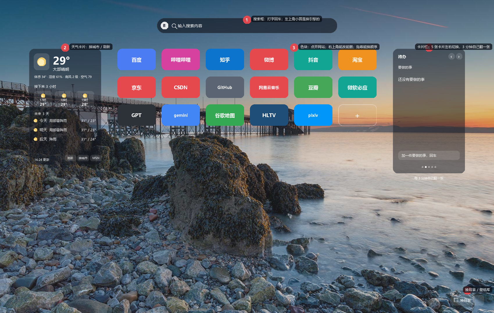
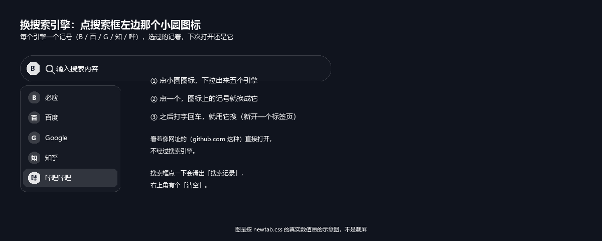
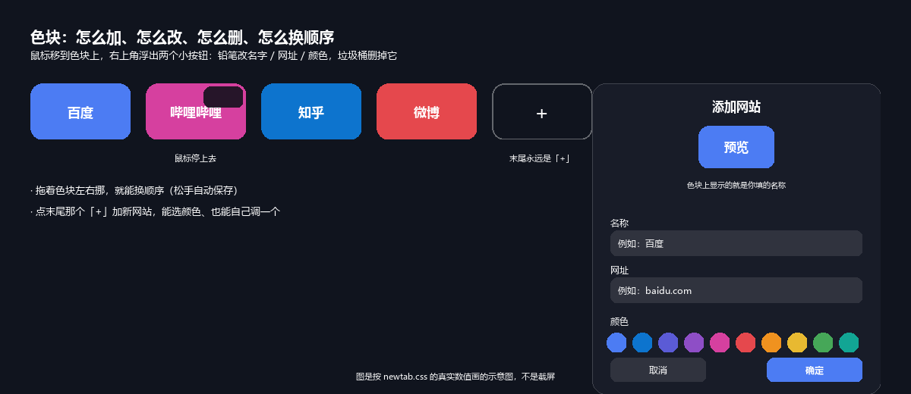
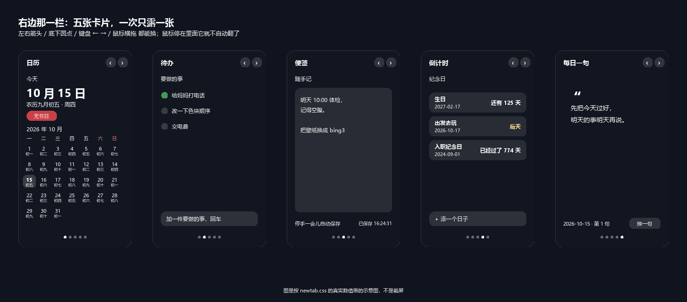
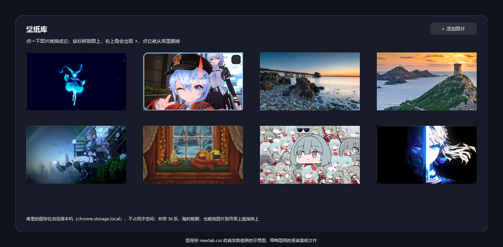

# NKtab

一个**不用登录、不联网也能用、不要钱**的新标签页（Edge / Chromium，Manifest V3）。
没有 AI、没有账号、没有云端壁纸——你的网站、待办、便签、壁纸，全都留在这台电脑和你的浏览器账号里。

---

# 一、怎么装

1. 打开 Edge，地址栏输入 `edge://extensions/`
2. 打开左下角的**开发人员模式**
3. 点**加载解压缩的扩展**，选中这个文件夹（`NKtab` 整个目录）
4. 按 `Ctrl+T` 打开新标签页

> 装好以后新标签页就换成它了。想换回来：`edge://extensions/` 里把它停用或移除即可。

### 更新过代码之后看不到变化？

代码改完不用打包，但浏览器得知道：

1. `edge://extensions/` 里点扩展卡片上的**刷新**（↻）
2. **把已经开着的新标签页关掉**，再 `Ctrl+T` 开一个

已经开着的那一页不会自己变——它加载的是打开那一刻的旧代码。

---

# 二、怎么用

## 搜索框

|想干什么|怎么做|
|-|-|
|搜东西|在框里打字，按回车（在新标签页里打开结果）|
|直接开网址|输入 `github.com` 这种看着像网址的，回车直接打开，不经过搜索引擎|
|换搜索引擎|点框**左边那个小圆图标**，下拉里选（必应 / 百度 / Google / 知乎 / 哔哩哔哩）|
|用搜索记录|点一下搜索框，下面滑出以前搜过的；右上角有「清空」|

小圆图标里只写一个记号（`B` / `百` / `G` / `知` / `哔`），鼠标放上去能看到全名。
选过的引擎会记住，下次打开还是它。

## 网站色块

预置了一批常用站点，每个格子一个颜色，点一下就用**新标签页**打开。

|想干什么|怎么做|
|-|-|
|加一个|点末尾那个 `+`，填名字和网址（颜色能选，也能自己调一个）|
|改一个|鼠标移到色块上，右上角浮出小按钮 → 铅笔（改名字 / 网址 / 颜色）|
|删一个|同上，点垃圾桶|
|换顺序|按住色块左右拖，松手自动保存|

## 右边那一栏：五张卡片

一栏里叠了**五张卡片**，一次只露一张：

|卡片|能干什么|
|-|-|
|**日历**|今天的大字日期 + 星期 + 农历 + 节日；下面一整月日历格，每格小字带农历日，今天高亮|
|**待办**|加一条、勾掉、删掉。回车提交，改一下自动存，不用点保存|
|**便签**|一块自由文本，停手 0.4 秒自动存，右下角显示存的时间；清空要确认一次|
|**倒计时**|记纪念日，显示还有几天 / 已经过了几天；`今天` `明天` `后天` 说人话，7 天内高亮|
|**每日一句**|30 句本地句子，按日期取，同一天开几次都是同一句；不喜欢可以「换一句」|

**换张有五条路**：左右箭头、底下圆点、键盘 `←` `→`、鼠标横向拖、手机上横滑。
看的是哪张会记住，下次打开还在那一张。

**没人碰的时候它自己会翻**：每 3 分钟换下一张。
鼠标停在这一栏里、或者标签页切到后台，它就停着不动；
你自己点过箭头 / 圆点 / 键盘之后，计时重新开始数，不会刚翻过去又被自动翻走。

想改快改慢：`newtab.js` 里的 `PANEL_AUTOPLAY_MS`（单位毫秒，默认 `3 * 60 * 1000`）。

## 左边：天气

- 只连 MSN 天气，**这是整个扩展唯一会联网的地方**
- 换城市：天气卡底部那排小字里的「换城市」
- 刷新：同一排里的「刷新」；平时数据是缓存着的，隔一段时间才自动重新拉
- 一次显示：当前温度 / 体感 / 湿度 / 风 / 空气，接下来 3 小时，未来 3 天

## 换背景 / 壁纸库

右下角那个「换背景」按钮，或者往页面上**直接拖一张图片**，都能换。

- 自带 **36 张**壁纸（就在 `wallpapers/` 文件夹里，**完全不占**浏览器存储）
- 也能自己加图：库里点「＋ 添加图片」，选本机的图
- 鼠标移到某张图上，右上角出现叉，点它就从库里删掉
- 你加的图存在浏览器本机（`chrome.storage.local`），不会同步到别的设备
- 想换掉自带的图：直接覆盖 `wallpapers/` 里同名文件即可

---

# 三、它把数据存在哪

|东西|存哪|会不会跟着账号同步|
|-|-|-|
|网站色块、待办、便签、倒计时、搜索引擎、搜索记录、当前卡片|`chrome.storage.sync`|会（都是纯文本，很小）|
|壁纸（自带的 + 你加的）|自带在读扩展目录；加的放 `chrome.storage.local`|不会|
|天气数据|`chrome.storage.local`|不会|

扩展只要了两个权限：`storage`（存上面那些）和 `unlimitedStorage`（壁纸图比较大）。
联网只发给 MSN 天气那一个域名，别的什么都不连。

---

# 四、怎么改

改完不用打包，回 `edge://extensions/` 点「刷新」再 `Ctrl+T` 就行。

改之前最好跑一遍校验和测试（都在 `tools/` 里，`node tools\xxx.mjs` 直接跑）：

|脚本|查什么|
|-|-|
|`node tools\check.mjs`|HTML 的 id、JS 的 import、CSS 的 class 和变量对不对得上|
|`node tools\测试侧栏轮播.mjs`|卡片换张的五条路、自动翻页、边界、存的位置|
|`node tools\测试农历.mjs`|农历表跟权威实现的 73384 天逐日对账|
|`node tools\测试搜索.mjs`|引擎表的拼地址、网址判断、换引擎那个菜单|
|`node tools\测试图标层级.mjs`|搜索框左边的图标没被输入框盖住（z-index 回归）|
|`node tools\测试页面结构.mjs`|页面骨架没被改坏（背景层、三栏对称、色块宫格是空的、卡片壳）|
|`node tools\测试壁纸库.mjs`|壁纸库的增删改查|
|`node tools\测试预置补全.mjs`|老用户补预置站点、自己删掉的不会被塞回来|

`tools\假DOM.mjs` 不是测试脚本本身，是给上面那几个「要跑浏览器代码」的测试共用的一套假
DOM / 假 localStorage；要换一份存储再跑一遍 `newtab.js`，用它的 `reloadNewtab()`。

生成类脚本（要联网，`python -X utf8 tools\xxx.py`）：

|脚本|生成什么|
|-|-|
|`tools\gen_lunar_table.py`|`lunar.js` 里那张农历表（`--check` 只核对不改文件）|
|`tools\gen_preview.py`|`预览.html`（本地双击看样子的，不进仓库）|
|`tools\gen_docs_images.py`|`docs/` 里 README 用的那几张说明图|

## 文件结构

|路径|作用|
|-|-|
|`manifest.json`|扩展的身份证（Manifest V3）|
|`newtab.html` / `newtab.css` / `newtab.js`|门面：新标签页本身，含右边那栏卡片轮播|
|`storage.js`|数据层：小抽屉（同步）/ 大柜子（本机）/ 临时桌面|
|`weather.js`|天气小组件（唯一会联网的部分，只连 MSN 天气）|
|`search.js`|搜索引擎表 + 「这是网址还是搜索词」的判断|
|`lunar.js`|农历换算表（1900–2100），日历卡片用的|
|`cards.js`|右边那栏五张卡片的画法与交互|
|`icons/`|扩展图标 16 / 48 / 128|
|`wallpapers/`|内置壁纸（36 张）|
|`docs/`|README 里那几张说明图（图示是按 `newtab.css` 的真实数值画的，不是截图）|
|`tools/`|测试与生成脚本（Python / Node），不是扩展运行时的一部分|

## 文档

* [V1-功能清单.md](V1-功能清单.md) —— 最早那份 V1 规格，看历史用；里面有「明确不做小卡片」这类话，后来推翻了，以代码为准

> 原来还有《大白话说明》《技术框架设计》《使用说明》三份，已经从工作区删掉；
> 需要的话用 `git show HEAD:使用说明.md` 之类取回来（提交 `3b1db79` 之前都还在）。
